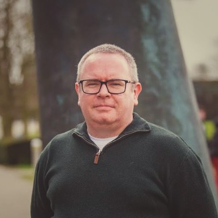

```{=html}
<section class="hero">
  <div>
    <p class="hero-name">Seán Ó Fithcheallaigh</p>
    <h1 class="hero-tagline">Small devices share insights, not data. <span>I build the networks and trust that make it work.</span></h1>
    <p class="hero-sub">PhD researcher at Ulster University, working on federated learning for resource-constrained devices.</p>
    <p class="hero-links"><a href="https://github.com/ofithcheallaigh">GitHub</a></p>
  </div>
  
</section>
```

::: {.home-section}
## About

I'm a PhD researcher at Ulster University, where I also lecture part-time. My research looks at how networks of resource-constrained devices can train machine learning models together without sharing raw data, and how to decide which devices should work together and which to trust.

Before moving into AI research, I worked in industry as a hardware and software engineer at Schrader Electronics and Sensata Technologies. That background shapes my focus on systems that work on real, constrained hardware.

## Education and experience
:::

```{=html}
<div class="timeline-wrap">
  <p class="timeline-legend"><span class="edu">Education</span><span class="work">Employment</span></p>
  <ol class="timeline">
    <li class="edu"><div class="label"><strong>2010</strong>BEng Electronic Engineering<br>Dundalk Inst. of Technology</div></li>
    <li class="edu"><div class="label"><strong>2011</strong>BEng (Hons) Electronic Systems<br>Dundalk Inst. of Technology</div></li>
    <li class="work"><div class="label"><strong>2012</strong>Hardware Engineer<br>Schrader Electronics</div></li>
    <li class="note"><div class="label"><strong>2014</strong>Schrader Electronics bought by Sensata Technologies</div></li>
    <li class="edu"><div class="label"><strong>2015</strong>BEng (Hons) System Engineering<br>Portsmouth University</div></li>
    <li class="edu"><div class="label"><strong>2021</strong>PGCert Artificial Intelligence<br>Ulster University</div></li>
    <li class="edu"><div class="label"><strong>2023</strong>MSc Artificial Intelligence<br>Ulster University</div></li>
    <li class="edu"><div class="label"><strong>2024–now</strong>PhD Artificial Intelligence<br>Ulster University<br>Full-time from 2025</div></li>
    <li class="work"><div class="label"><strong>2024</strong>Software &amp; System Engineer<br>Sensata Technologies</div></li>
    <li class="note"><div class="label"><strong>2024</strong>Left Sensata Technologies</div></li>
    <li class="work"><div class="label"><strong>2025</strong>Visiting Researcher (BTIIC)<br>Ulster University</div></li>
    <li class="work"><div class="label"><strong>2026</strong>PCRC Living Lab<br>Ulster University</div></li>
    <li class="work"><div class="label"><strong>2026</strong>Part-time Lecturer<br>Ulster University</div></li>
  </ol>
</div>
```

